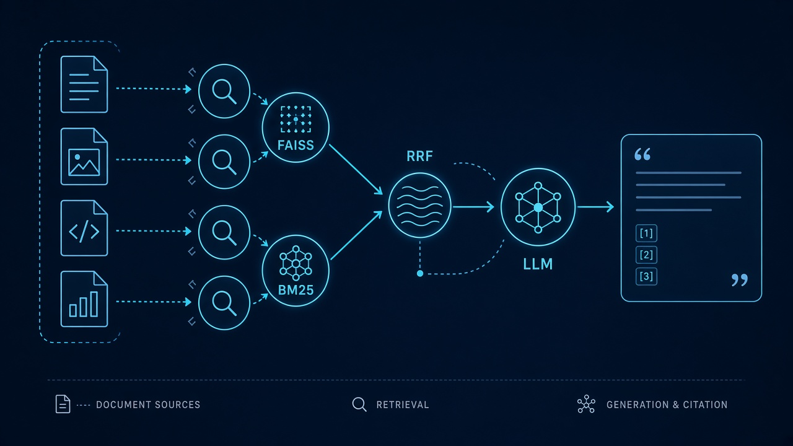
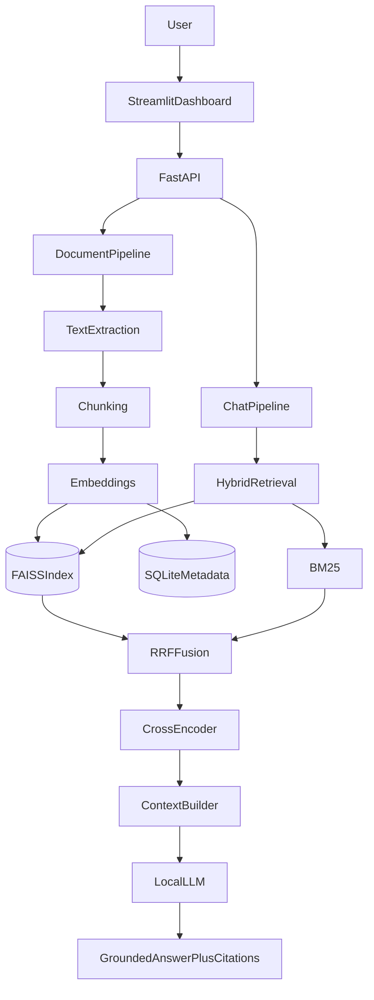
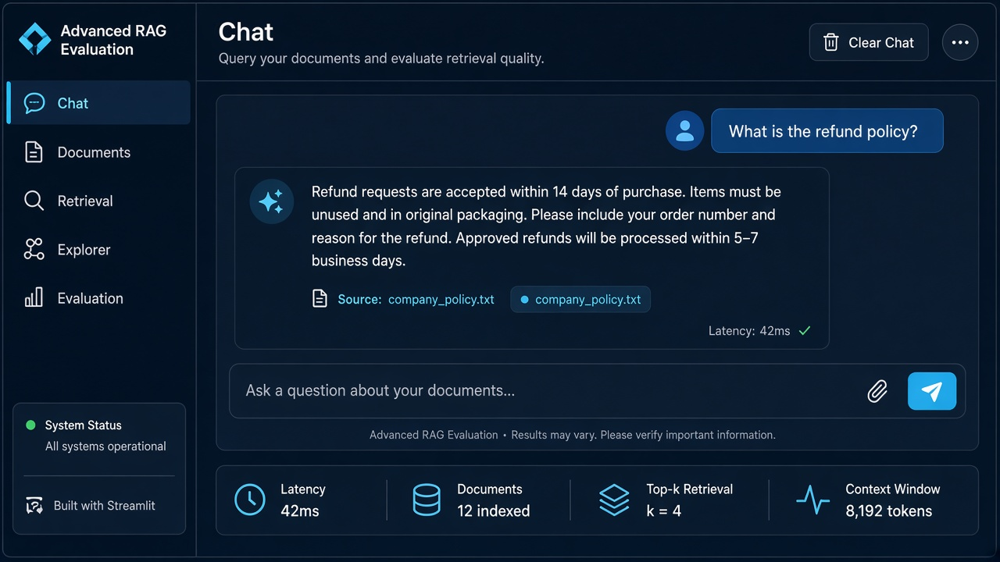
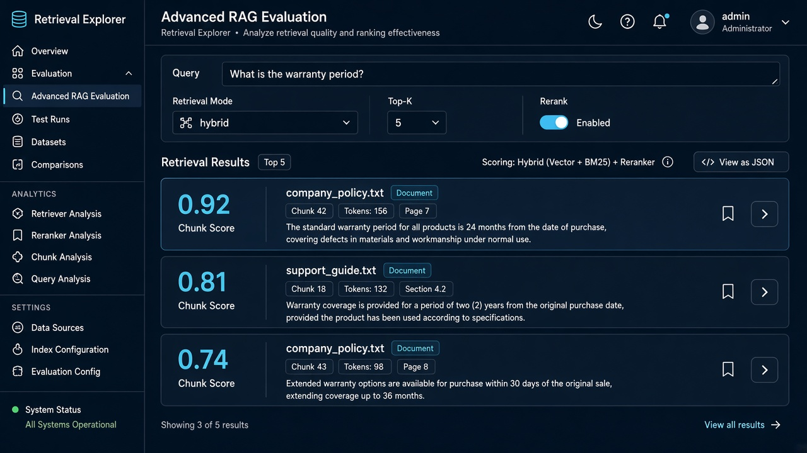
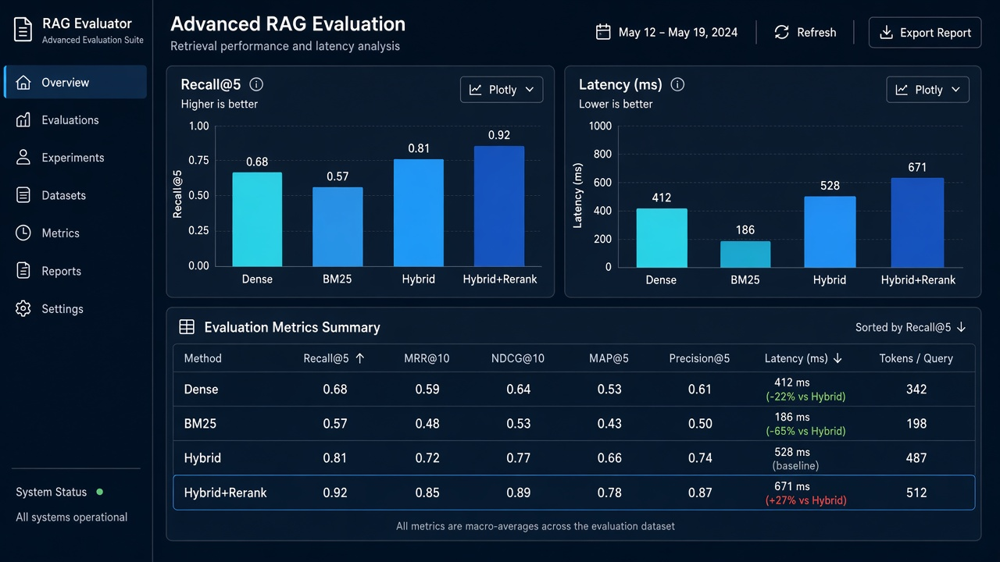
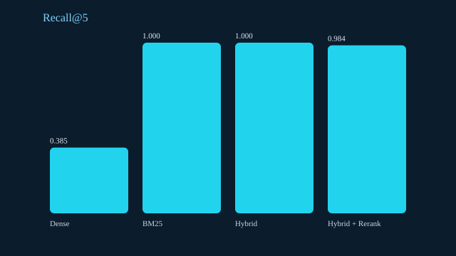
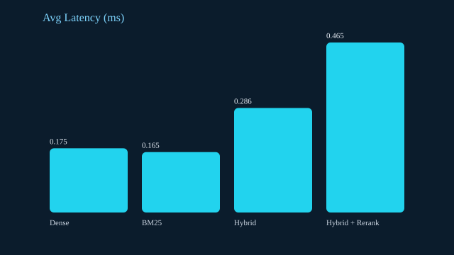

# Advanced RAG Evaluation



Production-oriented Retrieval-Augmented Generation system featuring **hybrid search (FAISS + BM25 + RRF)**, **cross-encoder reranking**, **grounded local generation**, **automated retrieval/answer evaluation**, FastAPI, Streamlit, and Docker.

> Suggested GitHub description: *Production-oriented RAG system featuring hybrid search, cross-encoder reranking, grounded generation, automated evaluation, FastAPI, Streamlit, and Docker.*

This is not a toy chatbot wrapper. The project emphasizes measurable retrieval quality, abstention under insufficient evidence, index consistency, and reproducible experiments suitable for AI Engineer / LLM Engineer portfolio review.

**Tests:** `27 passed` with mock models (no GPU / no paid APIs) — see [Testing](#testing).

---

## Key Features

- Document ingestion for **PDF / DOCX / TXT** with SHA-256 duplicate detection
- Character-based chunking (`CHUNK_SIZE`/`CHUNK_OVERLAP` in **characters**) with paragraph-aware and fixed strategies
- Dense retrieval via **FAISS `IndexFlatIP`** on L2-normalized embeddings (cosine)
- Sparse retrieval via **BM25** with English + Persian normalization/tokenization
- **Hybrid retrieval** with Reciprocal Rank Fusion (`RRF_K=60`)
- Optional **Cross-Encoder reranking**
- Grounded answers with source citations and explicit abstention
- Multi-turn conversations in SQLite + optional query rewriting
- Evaluation: Recall@K, Precision@K, MRR, NDCG@K, EM/F1, latency, experiment reports
- FastAPI + Streamlit + Docker Compose
- Pytest suite that runs with **mock models** (no GPU, no paid APIs)

---

## Technology Stack

| Layer | Choice |
|---|---|
| API | FastAPI, Pydantic, Uvicorn |
| UI | Streamlit, Plotly |
| Embeddings | Sentence Transformers (`BAAI/bge-m3` default) |
| Vectors | FAISS (`IndexFlatIP`) |
| Sparse | rank-bm25 |
| Reranker | CrossEncoder (`ms-marco-MiniLM-L-6-v2`) |
| LLM | Local Transformers (`Qwen/Qwen3-1.7B` default) |
| Metadata | SQLite |
| Eval | NumPy, Pandas, scikit-learn, custom metrics (+ Ragas-compatible hooks) |

### Embedding model trade-offs

| Model | Dims (approx.) | Memory | Notes |
|---|---|---|---|
| `BAAI/bge-m3` | 1024 | Higher | Strong multilingual retrieval; default quality target |
| `paraphrase-multilingual-MiniLM-L12-v2` | 384 | Lower | Faster CPU option; weaker on some long-doc cases |

**Embeddings from different models are not interchangeable.** Changing `EMBEDDING_MODEL` requires rebuilding the vector index.

### Reranker language note

`cross-encoder/ms-marco-MiniLM-L-6-v2` is primarily **English-oriented** and may underperform on Persian. Configure a multilingual reranker via `RERANKER_MODEL` (for example `cross-encoder/mmarco-mMiniLMv2-L12-H384-v1`).

---

## System Architecture



The evaluation pipeline (`scripts/run_evaluation.py` / `POST /evaluation/run`) is independent of Streamlit.

---

## RAG Pipeline

1. Validate and extract document text  
2. Normalize lightly (including Persian ی/ک variants)  
3. Chunk (character-based; paragraph-aware by default)  
4. Embed + index in FAISS; tokenize for BM25  
5. At query time: dense and/or sparse retrieval → RRF → optional rerank  
6. Build token-budgeted context with `[Source N]` headers  
7. Generate grounded answer or abstain  
8. Persist conversation turns in SQLite  

---

## Hybrid Retrieval

Modes: `dense` | `sparse` | `hybrid`

```text
RRF(d) = Σ 1 / (k + rank_i(d))   with default k = 60
```

Do **not** assume hybrid always wins — compare modes on the bundled benchmark.

---

## Evaluation Framework

Benchmark: [`data/evaluation/benchmark.json`](data/evaluation/benchmark.json) (35 items; EN + FA; factual, multi-doc, insufficient-evidence, follow-ups).

Relevance labels use verified **text spans** resolved to chunk IDs at runtime (chunking changes may remap IDs).

### Retrieval metrics

- Recall@K, Precision@K, MRR, NDCG@K  
- Compare Dense / BM25 / Hybrid / Hybrid+Rerank  

### Answer metrics

- Exact Match, token F1, abstention rate, latency  
- **Faithfulness:** Ragas-style LLM-judge faithfulness is documented as unavailable without a local/paid judge; a clearly labeled `lexical_support` diagnostic is provided and is **not** faithfulness  

Automated metrics do **not** guarantee factual correctness. Human review template: rate correctness / groundedness / completeness / citation accuracy on a 1–5 scale.

---

## Installation

```bash
python -m venv .venv

# Windows
.venv\Scripts\activate

# Linux/macOS
source .venv/bin/activate

pip install -r requirements.txt
cp .env.example .env
```

### Offline / CI-friendly mode

Set in `.env`:

```env
MOCK_MODELS=true
```

This uses deterministic mock embeddings/reranker/LLM so tests and demos run without downloading multi‑GB weights.

### Real models

Set `MOCK_MODELS=false` and ensure enough RAM/VRAM. First run downloads models from Hugging Face into the local cache. **Do not commit model weights.**

Approximate memory guidance (CPU):

| Profile | Embedding | LLM | RAM ballpark |
|---|---|---|---|
| Demo/mock | mock | mock | < 1 GB |
| Light | MiniLM | Qwen2.5-0.5B | 4–8 GB |
| Full (spec default) | bge-m3 | Qwen3-1.7B | 12–24 GB+ |

---

## Configuration

See [`.env.example`](.env.example). Important knobs:

- `EMBEDDING_MODEL`, `RERANKER_MODEL`, `LLM_MODEL`
- `CHUNK_SIZE`, `CHUNK_OVERLAP`, `CHUNK_STRATEGY=paragraph|fixed`
- `RETRIEVAL_MODE`, `TOP_K`, `RRF_K`, `ENABLE_RERANKING`
- `MAX_UPLOAD_SIZE_MB=20`

---

## Running Locally

Terminal 1 — API:

```bash
# recommended first run
set MOCK_MODELS=true   # Windows PowerShell: $env:MOCK_MODELS="true"
uvicorn app.main:app --host 127.0.0.1 --port 8000 --reload
```

Terminal 2 — UI:

```bash
streamlit run ui/streamlit_app.py
```

Ingest bundled samples:

```bash
python scripts/ingest_samples.py
python scripts/generate_office_samples.py   # optional PDF/DOCX copies
```

Rebuild indexes:

```bash
python scripts/build_index.py --mock
```

Run evaluation:

```bash
python scripts/run_evaluation.py --mock --experiment retrieval_compare
```

OpenAPI docs: `http://127.0.0.1:8000/docs`

---

## Examples

Runnable demos live in [`examples/`](examples/):

| Script | Needs API? | What it shows |
|---|---|---|
| [`examples/example_offline_pipeline.py`](examples/example_offline_pipeline.py) | No | Ingest → hybrid search → grounded answer in-process |
| [`examples/example_api_usage.py`](examples/example_api_usage.py) | Yes | Health, upload, search, chat, follow-up over HTTP |
| [`examples/curl_examples.sh`](examples/curl_examples.sh) | Yes | Same flows with curl |
| [`examples/sample_outputs.json`](examples/sample_outputs.json) | No | Captured mock-mode request/response payloads |

```bash
python examples/example_offline_pipeline.py
```

### Example chat (captured with mock models)

**Request**

```json
{
  "question": "What is the refund policy?",
  "retrieval_mode": "hybrid",
  "top_k": 3,
  "rerank": true
}
```

**Response** (abridged from `examples/sample_outputs.json`)

```json
{
  "answer": "…Refund requests are accepted within 14 days of purchase… [Source 1]",
  "sources": [
    {
      "document": "company_policy.txt",
      "chunk_id": "doc_001_chunk_000",
      "score": 3.035
    }
  ],
  "latency_ms": 42.31,
  "abstained": false
}
```

### Example curl

```bash
curl http://127.0.0.1:8000/health

curl -F "file=@data/documents/sample/company_policy.txt" \
  http://127.0.0.1:8000/documents/upload

curl -X POST http://127.0.0.1:8000/search \
  -H "Content-Type: application/json" \
  -d "{\"query\":\"What is the refund period?\",\"retrieval_mode\":\"hybrid\",\"top_k\":3,\"rerank\":true}"

curl -X POST http://127.0.0.1:8000/chat \
  -H "Content-Type: application/json" \
  -d "{\"question\":\"What is the refund policy?\",\"retrieval_mode\":\"hybrid\",\"top_k\":5,\"rerank\":true}"
```

---

## Docker Deployment

CPU-oriented Compose defaults use `MOCK_MODELS=true` so containers start without multi‑GB downloads. Persist DB/indexes via volumes; persist HF cache in `rag-models` when using real models.

```bash
docker compose up --build
```

- API: `http://127.0.0.1:8000`  
- UI: `http://127.0.0.1:8501`  

To use real models in Docker, set `MOCK_MODELS=false` and lighter model env vars (or mount a pre-warmed `/models` cache). **GPU/CUDA is not enabled by default** in this Compose file; add NVIDIA Container Toolkit and a CUDA base image if needed.

---

## Evaluation Experiments

| Experiment | What it compares |
|---|---|
| A — Retrieval strategy | Dense vs BM25 vs Hybrid |
| B — Reranking | Hybrid vs Hybrid+Rerank (quality + latency) |
| C — Chunk size | 400 / 800 / 1200 chars (rebuild indexes; keep overlap ratio ~0.1875) |

Reports land in `reports/metrics/` (JSON + CSV) and `reports/figures/` (SVG).

### Benchmark results (measured, mock models)

Generated with `MOCK_MODELS=true` after ingesting bundled sample documents (`scripts/ingest_samples.py` + `scripts/run_evaluation.py --mock --experiment retrieval_compare`). These scores validate the evaluation plumbing on deterministic mock embeddings/reranking — **not** production retrieval quality with `bge-m3` / a real cross-encoder.

| Method | Recall@5 | Precision@5 | MRR | NDCG@5 | Latency_ms_avg |
|---|---:|---:|---:|---:|---:|
| Dense | 0.385 | 0.088 | 0.217 | 0.251 | 0.18 |
| BM25 | 1.000 | 0.368 | 0.984 | 0.988 | 0.17 |
| Hybrid | 1.000 | 0.225 | 0.575 | 0.674 | 0.29 |
| Hybrid + Rerank | 0.984 | 0.219 | 1.000 | 0.988 | 0.46 |

Artifacts: `reports/metrics/retrieval_compare_*_report.json` and matching CSV/SVG.

Re-run with real models (after confirming downloads):

```bash
# set MOCK_MODELS=false in .env first
python scripts/ingest_samples.py --real-models
python scripts/run_evaluation.py --experiment retrieval_compare_real
```

---

## Screenshots

UI previews (dark navy + cyan theme):

| Chat | Retrieval Explorer |
|---|---|
|  |  |



Evaluation charts from a real mock-mode run:

| Recall@5 | Latency |
|---|---|
|  |  |

---

## Project Structure

```text
Advanced-RAG-Evaluation/
├── app/                 # FastAPI + RAG core
├── ui/streamlit_app.py  # Dashboard
├── examples/            # Offline + API demos + sample outputs
├── docs/screenshots/    # README images
├── data/
│   ├── documents/sample/
│   ├── indexes/
│   └── evaluation/benchmark.json
├── tests/
├── scripts/
├── reports/
├── Dockerfile
└── docker-compose.yml
```

---

## Testing

All automated tests run **without** downloading large models (`MOCK_MODELS=true`), without GPU, and without paid APIs.

```bash
pytest -q
```

### Latest local run

```text
...........................                                              [100%]
27 passed, 1 warning in 5.72s
```

| File | Covers |
|---|---|
| `tests/test_ingestion.py` | Upload validation, extraction, chunking, duplicates, delete+rebuild |
| `tests/test_retrieval.py` | EN/FA tokenization, RRF, FAISS cosine, hybrid search, metadata filters |
| `tests/test_generation.py` | Context budget, citations, abstention, conversation memory |
| `tests/test_evaluation.py` | Recall/Precision/MRR/NDCG, span→chunk label resolution, report files |
| `tests/test_api.py` | `/health`, upload, search, chat, delete, rejection of bad files |

```bash
# verbose single module
pytest tests/test_retrieval.py -v
```

---

## Reliability notes

- Duplicate uploads detected via SHA-256  
- Failed ingestion rolls back metadata/files and rebuilds indexes  
- Document deletion rebuilds FAISS + BM25 (acceptable at portfolio scale)  
- Index writes use temp files + replace  
- If index load fails, the API reports degraded health; rebuild with `scripts/build_index.py`  
- Single-writer assumption (no distributed locks)

Interrupted index updates: incomplete temp files are discarded; last successfully replaced index remains. On next successful rebuild, metadata and vectors are synchronized from SQLite chunks.

---

## Security

Upload size limits, extension/content checks, safe filenames, validated requests, localhost binding by default, CORS allow-list. **This API is not suitable for public internet exposure without authentication and additional hardening.**

---

## Limitations

- Local LLM quality depends on hardware and model size  
- Default English reranker is weak for Persian  
- Character chunking is not token-perfect  
- Mock model mode is for tests/demos only  
- FAISS flat IP is exact but not scaled to millions of vectors  
- Faithfulness without an LLM judge is intentionally not overstated  

---

## Future Improvements

- Hybrid weights learned per domain  
- Parent-child / late-chunking strategies  
- Persistent incremental FAISS deletion IDs  
- Local LLM-as-judge faithfulness loop  
- AuthN/AuthZ and multi-tenant corpora  

---

## License

MIT — see [LICENSE](LICENSE).
